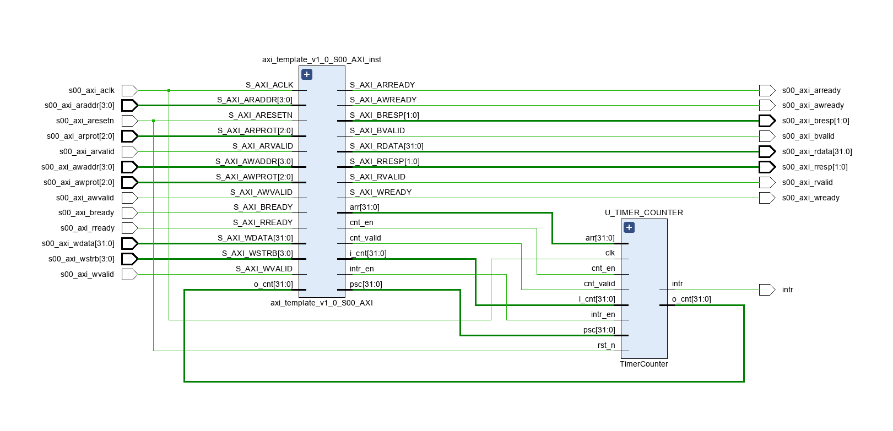
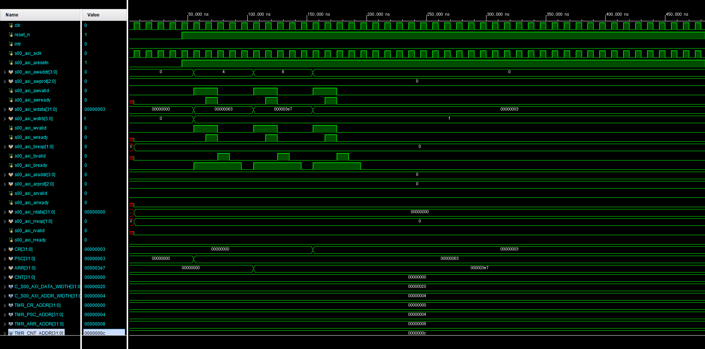

# AXI4-Lite GPIO 제어와 Embedded C 연동

Basys3 FPGA의 MicroBlaze에서 Vitis Embedded C를 사용해 AXI4-Lite GPIO 주변장치를 제어한 프로젝트입니다. MMIO(Memory-Mapped I/O) 방식으로 LED 출력, FND 표시 및 버튼 입력을 연결하고 실제 보드에서 동작을 확인했습니다.

이 폴더에는 **GPIO 제어용 C 애플리케이션**과 **AXI4-Lite Timer IP의 RTL·테스트벤치**가 함께 들어 있습니다. GPIO와 Timer는 서로 다른 주변장치이므로 아래에서 소스 구성과 레지스터 맵을 구분해 설명합니다.

## 개발 환경

| 항목 | 내용 |
| --- | --- |
| FPGA 보드 | Digilent Basys3 |
| 프로세서 | MicroBlaze |
| 개발 도구 | Vivado 2020.2 / Vitis 2020.2 |
| 사용 언어 | C / Verilog / SystemVerilog |
| GPIO 프로젝트 기간 | 2026.06.18 - 2026.06.26 |

## 핵심 구현 내용

- GPIO 레지스터를 C 구조체와 주변장치 기준 주소로 연결한 MMIO 제어
- GPIO HAL, 주변장치 제어 코드, 애플리케이션으로 나눈 소프트웨어 구성
- 비트 마스크를 이용한 GPIO 입력 읽기와 출력 설정
- 16-bit LED 출력과 점등 패턴, FND 숫자 표시, 버튼 이벤트 처리
- STOP·RUN·CLEAR 상태를 이용한 스톱워치 제어
- 별도 Timer IP의 prescaler, auto-reload, counter load 및 interrupt 출력 구현

## GPIO 하드웨어와 소프트웨어의 연결

MicroBlaze가 AXI4-Lite를 통해 GPIO 레지스터에 접근하고, Embedded C 애플리케이션이 해당 레지스터를 읽고 써서 주변장치를 제어합니다.

| 순서 | 구성 요소 | 역할 |
| --- | --- | --- |
| 1 | 스톱워치 애플리케이션 | 버튼 이벤트에 따른 상태 전이와 표시 데이터 결정 |
| 2 | LED / Button / FND 제어 코드 | 주변장치별 입출력 동작 구성 |
| 3 | GPIO HAL | 레지스터 읽기·쓰기와 핀 단위 비트 연산 |
| 4 | AXI4-Lite GPIO | 소프트웨어의 레지스터 접근과 보드 입출력 연결 |

### GPIO 레지스터 맵

다음은 [GPIO.h](src/HAL/GPIO/GPIO.h)에 정의한 C 애플리케이션의 GPIO 레지스터 맵입니다.

| Offset | 레지스터 | 역할 |
| --- | --- | --- |
| `0x00` | CR | 핀별 입출력 방향 설정 |
| `0x04` | IDR | 입력 데이터 읽기 |
| `0x08` | ODR | 출력 데이터 읽기·쓰기 |

관련 GPIO RTL과 IP 패키징 자료는 [05_Custom_IP/gpio_1.0](../05_Custom_IP/gpio_1.0/)에 있습니다.

각 레지스터를 `volatile uint32_t` 멤버로 정의하고, `xparameters.h`의 기준 주소를 `GPIO_TypeDef *`로 연결했습니다. CR은 핀별로 0을 입력, 1을 출력으로 사용하는 구조입니다.

| GPIO 인스턴스 | C 코드의 용도 |
| --- | --- |
| GPIOA | FND 세그먼트 데이터 |
| GPIOB | FND 자리 선택 및 버튼 입력 |
| GPIOC | 하위 8개 LED 출력 |
| GPIOD | 상위 8개 LED 출력 |

[GPIO.c](src/HAL/GPIO/GPIO.c)는 `GPIO_ReadPin()`, `GPIO_WritePin()`, `GPIO_ReadPort()`, `GPIO_WritePort()` 등을 제공해 레지스터 접근을 함수로 구성합니다.

## Embedded C 소프트웨어 구성

| 경로 | 주요 내용 |
| --- | --- |
| [src/main.c](src/main.c) | 초기화 후 스톱워치 실행, FND 갱신, 소프트웨어 tick 증가 및 지연 호출 |
| [src/HAL/GPIO/](src/HAL/GPIO/) | GPIO 레지스터 구조체, 기준 주소, 입력 읽기와 출력 쓰기 |
| [src/driver/LED/](src/driver/LED/) | 두 GPIO 포트를 이용한 16-bit LED 출력 |
| [src/driver/Button/](src/driver/Button/) | 이전·현재 입력 상태를 비교한 버튼 이벤트 처리 |
| [src/driver/FND/](src/driver/FND/) | 숫자·소수점 데이터와 자리 선택을 이용한 FND 표시 |
| [src/ap/StopWatch.c](src/ap/StopWatch.c) | STOP·RUN·CLEAR 상태 전이, 시간 데이터 및 LED 표시 제어 |
| [src/common/delay/](src/common/delay/) | 소프트웨어 tick과 지연 함수 |

### 버튼과 스톱워치 동작

- 버튼의 이전 상태와 현재 상태를 비교해 눌림·해제 이벤트를 구분합니다.
- STOP 상태에서는 실행 버튼으로 RUN, 초기화 버튼으로 CLEAR 상태로 전환합니다.
- RUN 상태에서는 실행 버튼으로 STOP 상태로 전환합니다.
- CLEAR 상태에서는 시간 데이터를 초기화하고 STOP 상태로 돌아갑니다.
- FND는 표시 자리를 순환하며 숫자를 출력합니다.

현재 스톱워치의 시간 처리는 `main.c`의 `incTick()`과 `delay_ms(1)` 호출을 이용한 소프트웨어 tick 구조입니다. 아래 Timer IP의 interrupt 출력은 별도 RTL·테스트벤치의 대상입니다.

## 빌드 과정에서 해결한 문제

Vitis 프로젝트에서 BSP 헤더와 `xparameters.h`가 생성되지 않아 애플리케이션을 컴파일할 수 없는 문제가 있었습니다. BSP 생성과 애플리케이션 빌드 순서, Makefile 설정을 점검하고 순서 및 오타를 수정해 빌드를 정상화했습니다.

이 과정에서 하드웨어 플랫폼, BSP, 애플리케이션 사이의 관계와 빌드 순서를 함께 확인했습니다.

## 별도 구성인 AXI4-Lite Timer IP

Timer 관련 소스는 메모리 매핑 레지스터를 통해 설정할 수 있는 카운터와 AXI4-Lite 인터페이스를 구성합니다.

| 경로 | 역할 |
| --- | --- |
| [RTL/TimerCounter.v](RTL/TimerCounter.v) | Prescaler, auto-reload, counter load 및 interrupt 출력 |
| [hdl/axi_template_v1_0.v](hdl/axi_template_v1_0.v) | AXI 인터페이스와 TimerCounter 연결 |
| [hdl/axi_template_v1_0_S00_AXI.v](hdl/axi_template_v1_0_S00_AXI.v) | AXI4-Lite Slave 레지스터와 read/write 처리 |
| [tb/tb_TimerCounter.sv](tb/tb_TimerCounter.sv) | TimerCounter 단위 자극과 카운터 동작 관찰 |
| [tb/tb_axi_timer.sv](tb/tb_axi_timer.sv) | AXI 쓰기를 통한 Timer 설정과 interrupt 발생 관찰 |

### Timer 레지스터 맵

이 표는 Timer용 AXI wrapper의 맵이며, 앞의 GPIO 맵과 구분됩니다.

| Offset | 레지스터 | 역할 |
| --- | --- | --- |
| `0x00` | CR | bit 0: counter enable / bit 1: interrupt enable |
| `0x04` | PSC | Prescaler 설정 |
| `0x08` | ARR | Auto-reload 값 설정 |
| `0x0C` | CNT | 읽기: 현재 카운터 값 / 쓰기: 카운터 로드 값 |

테스트벤치는 PSC·ARR 설정, 카운터 로드 및 interrupt 관찰을 위한 시나리오를 제공합니다. `tb_axi_timer.sv`의 실행 시나리오는 AXI 쓰기로 Timer를 설정한 뒤 `intr` 발생을 기다리는 흐름입니다. 검증 결과는 파형 관찰을 기준으로 정리하며, 자동 PASS/FAIL 판정이나 전체 AXI 프로토콜 검증을 의미하지 않습니다.

## 보드 확인과 저장된 자료

GPIO 프로젝트에서는 Basys3에서 LED 출력, FND 숫자 표시와 버튼 입력을 확인했습니다.

### Vivado Block Design

### 저장된 파형 캡처

## 실행에 필요한 구성

- **GPIO C 애플리케이션:** GPIO 레지스터 맵을 구현한 MicroBlaze 하드웨어 플랫폼과 Vitis BSP가 필요합니다. `xparameters.h`의 GPIO 기준 주소가 해당 플랫폼과 일치해야 합니다.
- **Timer RTL 시뮬레이션:** `RTL/`과 `hdl/`의 Verilog 소스를 시뮬레이션 프로젝트에 추가하고, `tb/`의 대상 테스트벤치를 선택합니다.

현재 이 폴더의 `hdl/`에 있는 AXI wrapper는 Timer용입니다. GPIO용 HDL과 IP 패키지는 [05_Custom_IP/gpio_1.0](../05_Custom_IP/gpio_1.0/)을 참고합니다. GPIO 보드 애플리케이션 실행에는 이 IP를 통합한 MicroBlaze 하드웨어 프로젝트와 해당 XSA, bitstream, BSP가 필요합니다.

## 배운 점

C의 구조체·포인터·비트 연산을 레지스터 제어에 적용하고, 하드웨어 기능을 소프트웨어에서 사용하는 과정을 경험했습니다. 또한 주변장치 제어와 애플리케이션을 나누어 구성하고, 코드뿐 아니라 BSP 생성 및 보드 동작까지 함께 확인하는 개발 흐름을 익혔습니다.

