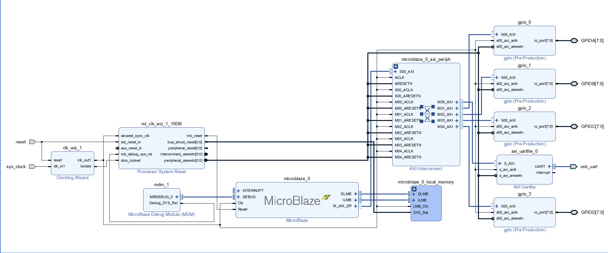

# AXI4-Lite GPIO와 Custom IP 패키징

Vivado에서 사용하는 Custom IP 패키징 자료와 GPIO 제어용 C 소스를 정리한 폴더입니다. GPIO 하드웨어의 레지스터 구조와 소프트웨어 제어를 연결해 살펴볼 수 있습니다.

## 먼저 볼 자료

| 자료 | 내용 |
| --- | --- |
| [GPIO Top RTL](gpio_1.0/hdl/gpio_v1_0.v) | 8-bit GPIO 입출력과 AXI4-Lite 인터페이스 연결 |
| [GPIO AXI Slave RTL](gpio_1.0/hdl/gpio_v1_0_S00_AXI.v) | CR·IDR·ODR 레지스터 접근 처리 |
| [GPIO HAL 헤더](gpio_1.0/src/HAL/GPIO/GPIO.h) | 레지스터 구조체와 주변장치 기준 주소 |
| [GPIO HAL 구현](gpio_1.0/src/HAL/GPIO/GPIO.c) | 레지스터 읽기·쓰기와 핀 단위 제어 |
| [스톱워치 애플리케이션](gpio_1.0/src/ap/StopWatch.c) | 버튼 입력과 상태 전이, 표시 데이터 구성 |
| [보드 연동 프로젝트 설명](../02_AXI4_Lite_GPIO/README.md) | 개발 환경, 주변장치 제어, 빌드 문제 해결 및 보드 확인 내용 |

## GPIO 하드웨어 구조

`gpio_v1_0.v`는 AXI Slave 인터페이스와 8-bit `gpio` 모듈을 연결합니다. GPIO의 각 핀은 CR의 해당 비트에 따라 입력 또는 출력으로 동작합니다.

- CR 비트가 1이면 ODR의 해당 비트를 출력합니다.
- CR 비트가 0이면 출력 드라이브를 high-impedance로 두고 핀의 입력값을 읽습니다.
- 소프트웨어는 각 IP 인스턴스의 기준 주소와 레지스터 offset을 이용해 접근합니다.

| Offset | 레지스터 | GPIO에서의 역할 |
| --- | --- | --- |
| `0x00` | CR | 핀별 입출력 방향 설정 |
| `0x04` | IDR | 8-bit 핀 입력값 읽기 |
| `0x08` | ODR | 출력 데이터 설정 및 읽기 |

AXI 데이터 폭은 32-bit이며 GPIO 로직은 하위 8-bit를 사용합니다. C 코드의 `GPIO_TypeDef`도 이 레지스터 간격에 맞춰 구성되어 있습니다.

## 패키지 구성

| 폴더 | 저장된 자료 |
| --- | --- |
| [gpio_1.0/](gpio_1.0/) | GPIO HDL, IP 패키징 파일 및 C 애플리케이션 |
| [axi_template_1.0/](axi_template_1.0/) | AXI 인터페이스 관련 패키징 자료 |
| [led_f_1.0/](led_f_1.0/) | LED 관련 IP 패키징 자료 |
| [myip_1.0/](myip_1.0/) | Custom IP 패키징 실습 자료 |

각 IP 폴더에는 `component.xml`, `hdl/`, `drivers/`, `xgui/`와 예제 설계 파일 등이 포함되어 있습니다. Vivado가 생성한 메타데이터·드라이버 템플릿과 기능별 HDL·C 코드를 함께 보관하는 구성입니다.

## GPIO와 Timer 자료의 관계

이 폴더의 `gpio_1.0/hdl/`는 GPIO 구현입니다. [02_AXI4_Lite_GPIO/hdl](../02_AXI4_Lite_GPIO/hdl/)에 저장된 AXI wrapper는 Timer용이며 CR·PSC·ARR·CNT 맵을 사용합니다. GPIO용 CR·IDR·ODR 맵과 구분해 사용해야 합니다.

GPIO C 애플리케이션을 보드에서 실행하려면 GPIO IP를 통합한 MicroBlaze 하드웨어 플랫폼과 Vitis BSP가 필요합니다. 하드웨어에서 할당한 주소와 `xparameters.h`의 기준 주소를 맞춰 사용합니다.

## 저장된 Block Design 자료

